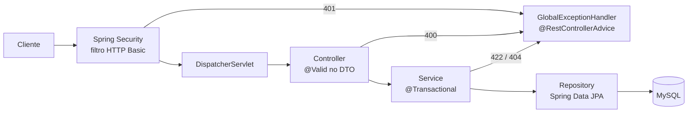

# Mini-autorizador

Mini-autorizador de transações de cartões.

É uma API REST em Spring Boot que:

- **cria cartões**, cada um com saldo inicial de **R$ 500,00**;
- **consulta o saldo** de um cartão;
- **autoriza transações**, debitando o saldo quando o cartão existe, a senha confere e há saldo suficiente.

Todos os endpoints exigem **HTTP Basic** (`username` / `password`).

## Sumário

- [Stack](#stack)
- [Como rodar](#como-rodar)
- [API](#api)
- [Como funciona](#como-funciona)
- [Decisões de arquitetura (ADRs)](#decisões-de-arquitetura-adrs)
- [Testes](#testes)
- [Estrutura do projeto](#estrutura-do-projeto)

## Stack

| Item | Escolha |
|---|---|
| Linguagem | Java 25 |
| Framework | Spring Boot 4.1.1 (Web MVC, Validation, Security, Data JPA) |
| Banco | MySQL (serviço `mysql` do `docker-compose.yml`) |
| Schema | Liquibase (changelogs em SQL) |
| Build | Maven via wrapper (`./mvnw`) |
| Testes | JUnit 5, Spring Boot Test, MockMvc, H2 em memória, JaCoCo |
| Utilitários | Lombok |

## Como rodar

Pré-requisitos: JDK 25 e Docker.

```bash
docker compose up -d        # sobe o MySQL em localhost:3306 (banco miniautorizador, root sem senha)
./mvnw spring-boot:run      # aplica o changelog do Liquibase e sobe a API em http://localhost:8080
./mvnw verify               # testes + relatório de cobertura (target/site/jacoco/index.html); não precisa do Docker
docker compose down -v      # derruba o banco e apaga os dados
```

A configuração fica em `src/main/resources/application.properties` e pode ser sobrescrita por variáveis de
ambiente:

| Variável | Padrão | Uso |
|---|---|---|
| `DB_URL` | `jdbc:mysql://localhost:3306/miniautorizador?...` | URL do banco |
| `DB_USERNAME` / `DB_PASSWORD` | `root` / vazio | credenciais do banco |
| `API_USERNAME` / `API_PASSWORD` | `username` / `password` | credenciais do HTTP Basic |

### Testando na mão

```bash
curl -u username:password -X POST localhost:8080/cartoes \
  -H 'Content-Type: application/json' -d '{"numeroCartao":"6549873025634501","senha":"1234"}'

curl -u username:password localhost:8080/cartoes/6549873025634501

curl -u username:password -X POST localhost:8080/transacoes \
  -H 'Content-Type: application/json' \
  -d '{"numeroCartao":"6549873025634501","senhaCartao":"1234","valor":10.00}'
```

## API

### Criar cartão — `POST /cartoes`

```json
{ "numeroCartao": "6549873025634501", "senha": "1234" }
```

| Situação | Status | Corpo |
|---|---|---|
| Criado | `201` | `{"cardNumber": "6549873025634501", "password": "1234"}` |
| Número já cadastrado | `422` | erro padrão (ver abaixo) |
| Payload inválido | `400` | erro padrão com a lista de campos |

O número do cartão deve ter de 13 a 19 dígitos; a senha, até 72 caracteres (limite do BCrypt).

### Consultar saldo — `GET /cartoes/{numeroCartao}`

| Situação | Status | Corpo |
|---|---|---|
| Encontrado | `200` | `495.15` |
| Não existe | `404` | vazio |

### Autorizar transação — `POST /transacoes`

```json
{ "numeroCartao": "6549873025634501", "senhaCartao": "1234", "valor": 10.00 }
```

| Situação | Status | Corpo |
|---|---|---|
| Autorizada | `201` | `OK` |
| Cartão não existe | `422` | `CARTAO_INEXISTENTE` |
| Senha errada | `422` | `SENHA_INVALIDA` |
| Saldo menor que o valor | `422` | `SALDO_INSUFICIENTE` |
| Payload inválido | `400` | erro padrão com a lista de campos |

As regras são avaliadas nessa ordem (cartão → senha → saldo) e a primeira que falhar define a resposta.

### Autenticação e erros

Sem credencial, ou com credencial errada, qualquer endpoint responde `401` com o cabeçalho `WWW-Authenticate`.

Erros que o contrato não define em detalhe usam um corpo JSON padrão (`ErrorResponseDTO`), sem stack trace:

```json
{
  "timestamp": "2026-10-15T12:00:00Z",
  "status": 400,
  "error": "Bad Request",
  "message": "Invalid request body.",
  "path": "/transacoes",
  "fields": [{ "field": "amount", "message": "must be greater than 0" }]
}
```

### Suposições e desvios do contrato

- **Nomes dos campos.** Os DTOs usam nomes em inglês (`cardNumber`, `password`, `amount`). Nos requests, os nomes
  do contrato (`numeroCartao`, `senha`, `senhaCartao`, `valor`) continuam aceitos via `@JsonAlias`; as respostas
  saem em inglês. Padrão descrito em [docs/patterns/dto.md](docs/patterns/dto.md).
- **Cartão duplicado.** O contrato devolve o próprio request no `422`; aqui o `422` traz o erro padrão, explicando
  ao cliente que o cartão já existe.
- **Valores.** Sempre `BigDecimal` com escala 2 (`DECIMAL(19,2)` no banco). O valor da transação precisa ser
  positivo e ter no máximo 2 casas decimais.
- **Tentativas de transação** são gravadas para auditoria ([ADR-0007](docs/adr/0007-registrar-tentativas-de-transacao-para-auditoria.md)),
  embora não seja um requisito. Não há endpoint de leitura; a consulta é via SQL.

## Como funciona

### Caminho de uma requisição no Spring



1. **Segurança** (`config/SecurityConfig`). Uma `SecurityFilterChain` exige autenticação em todas as rotas, sem
   sessão e sem CSRF (API stateless). O usuário vem de `spring.security.user.*`. Falhas de autenticação acontecem
   nos filtros, antes do Spring MVC; um `AuthenticationEntryPoint` repassa essas exceções ao
   `HandlerExceptionResolver`, para que o mesmo `@RestControllerAdvice` monte o `401`.
2. **Controller** (`controller/`). Recebe o JSON num `record` DTO e valida com Bean Validation (`@Valid`). Não tem
   regra de negócio: extrai os valores e chama o service.
3. **Service** (`service/`). Implementa os casos de uso e abre a transação do banco com `@Transactional`.
4. **Domínio** (`domain/`). `Card` guarda o saldo e sabe debitar e conferir a senha; as regras de autorização
   ficam em `domain/rule/`.
5. **Repository** (`repository/`). Interfaces Spring Data JPA; o Spring gera a implementação.
6. **Erros** (`exception/GlobalExceptionHandler`). Único ponto que traduz exceções em status e corpo HTTP.

Toda injeção de dependência é por construtor (`@RequiredArgsConstructor` do Lombok).

### Criação de cartão

`CardService.create` monta o cartão com `Card.create`, que grava apenas o **hash BCrypt** da senha
([ADR-0005](docs/adr/0005-armazenar-senha-do-cartao-com-bcrypt.md)) e o saldo inicial de R$ 500,00.

O número do cartão é a chave primária. `Card` implementa `Persistable`, então salvar um cartão novo sempre gera um
`INSERT` (nunca um `merge` que sobrescreveria o existente). Um número repetido viola a chave primária, inclusive se
duas criações chegarem ao mesmo tempo, e vira `CardAlreadyExistsException` → `422`.

### Autorização de transação

As regras são objetos que implementam `AuthorizationRule`:

| Regra | Ordem | Recusa com |
|---|---|---|
| `PasswordRule` | `@Order(1)` | `SENHA_INVALIDA` |
| `BalanceRule` | `@Order(2)` | `SALDO_INSUFICIENTE` |

Cada regra é um `@Component`; o Spring injeta no `TransactionService` uma `List<AuthorizationRule>` já ordenada
pelo `@Order`. O método `validate` da interface usa `Optional.filter(...).orElseThrow(...)`, então o fluxo inteiro
não tem nenhum `if`. Para criar uma regra nova, basta outro `@Component` com `@Order`.

```java
@Transactional(noRollbackFor = TransactionRejectedException.class)
public void authorize(Transaction transaction) {
    Card card = cardRepository.findByNumberForUpdate(transaction.cardNumber())   // SELECT ... FOR UPDATE
            .orElseThrow(() -> new TransactionRejectedException(CARTAO_INEXISTENTE));
    rules.forEach(rule -> rule.validate(card, transaction));                     // senha, depois saldo
    card.debit(transaction.amount());                                            // gravado no commit
    // + registro de auditoria da tentativa (aprovada ou recusada)
}
```

### Concorrência

Duas transações simultâneas no mesmo cartão, mesmo em instâncias diferentes da aplicação, não podem deixar o saldo
negativo nem perder um débito. A solução fica no banco, não em memória
([ADR-0006](docs/adr/0006-autorizar-transacoes-com-regras-e-lock-pessimista.md)):

- `findByNumberForUpdate` usa `@Lock(PESSIMISTIC_WRITE)`, ou seja, `SELECT ... FOR UPDATE`;
- a linha do cartão fica travada até o commit, então a segunda transação espera a primeira terminar e já lê o saldo
  atualizado;
- o débito é gravado por *dirty checking* do Hibernate no commit, que também libera o lock;
- cartões diferentes não competem entre si.

Exemplo: cartão com R$ 10,00 e duas transações de R$ 10,00 ao mesmo tempo → uma recebe `OK`, a outra
`SALDO_INSUFICIENTE`, e o saldo final é R$ 0,00.

### Persistência

O schema é versionado pelo **Liquibase** ([ADR-0004](docs/adr/0004-adotar-liquibase-para-versionamento-de-schema.md))
e aplicado na subida da aplicação. O Hibernate só valida o mapeamento (`ddl-auto=validate`).

```
src/main/resources/db/changelog/
├── db.changelog-master.yaml
└── changes/
    ├── 001-create-card.sql           # card (card_number PK, password = hash BCrypt, balance)
    └── 002-create-transactions.sql   # transactions (auditoria das tentativas)
```

Um changeset já aplicado não deve ser editado; mudanças entram como um novo arquivo `NNN-descricao.sql` incluído no
master.

## Decisões de arquitetura (ADRs)

As decisões ficam em [docs/adr/](docs/adr/README.md), no formato de Michael Nygard (Contexto, Decisão, Alternativas,
Consequências). ADR aceito não é editado: uma mudança de decisão gera um ADR novo que substitui o anterior.

| ADR | Decisão | Status |
|---|---|---|
| [0000](docs/adr/0000-registro-de-decisoes-de-arquitetura.md) | Registrar as decisões como ADRs em `docs/adr/` | Aceito |
| [0001](docs/adr/0001-usar-mysql-para-persistencia.md) | MySQL do compose na aplicação; H2 em memória (`MODE=MySQL`) nos testes, para o `./mvnw verify` rodar sem Docker | Aceito |
| [0002](docs/adr/0002-adotar-flyway-para-versionamento-de-schema.md) | Flyway para versionar o schema | Substituído pelo 0004 |
| [0003](docs/adr/0003-arquitetura-em-camadas-simples.md) | Camadas simples (controller / service / domain / repository) em vez de hexagonal | Aceito |
| [0004](docs/adr/0004-adotar-liquibase-para-versionamento-de-schema.md) | Liquibase com *formatted SQL*: o Flyway Community da versão do Boot não suporta MySQL 5.7 | Aceito |
| [0005](docs/adr/0005-armazenar-senha-do-cartao-com-bcrypt.md) | Senha do cartão guardada como hash BCrypt, sem registrar um `PasswordEncoder` que afetaria o HTTP Basic | Aceito |
| [0006](docs/adr/0006-autorizar-transacoes-com-regras-e-lock-pessimista.md) | Regras de autorização polimórficas, sem `if`, e lock pessimista na linha do cartão | Aceito |
| [0007](docs/adr/0007-registrar-tentativas-de-transacao-para-auditoria.md) | Gravar todas as tentativas (aprovadas e recusadas) na tabela `transactions`, com UUIDv7 | Aceito |

Padrões de código: [docs/patterns/dto.md](docs/patterns/dto.md) (DTOs como `record` com sufixo `DTO`).

## Testes

```bash
./mvnw verify
```

Os testes rodam com o perfil `test` (ativado pelo Surefire) contra H2 em memória, sem passos manuais. O Liquibase
aplica o mesmo changelog no H2, o que valida o SQL e o mapeamento JPA a cada build.

| Tipo | Classes | O que garante |
|---|---|---|
| Unitário | `CardTest`, `CardPasswordHasherTest`, `PasswordRuleTest`, `BalanceRuleTest`, `CardServiceTest`, `TransactionServiceTest`, `GlobalExceptionHandlerTest` | Regras, débito, hash, cada motivo de recusa e a ordem das regras |
| Web (MockMvc) | `CardControllerTest`, `TransactionControllerTest`, `SecurityConfigTest` | Contratos: status, corpo, aliases, `400` e `401` |
| Repositório | `CardRepositoryTest`, `CardTransactionRepositoryTest` | Lock pessimista e gravação da auditoria |
| Integração | `CardIntegrationTest`, `TransactionIntegrationTest` | Fluxo completo de ponta a ponta |
| Concorrência | `TransactionIntegrationTest` | 20 débitos simultâneos de R$ 50,00 num cartão de R$ 500,00 → exatamente 10 `OK`, 10 `SALDO_INSUFICIENTE` e saldo 0 |

O H2 não reproduz exatamente o isolamento do InnoDB; o comportamento contra o MySQL real é conferido
manualmente com os comandos de [Testando na mão](#testando-na-mão).

## Estrutura do projeto

```
src/main/java/br/com/mini_authorizer/
├── config/        # SecurityConfig (HTTP Basic, stateless)
├── controller/    # CardController, TransactionController
│   └── dto/       # records de request/response
├── service/       # CardService, TransactionService
├── domain/        # Card, CardTransaction, Transaction, enums, CardPasswordHasher
│   └── rule/      # AuthorizationRule, PasswordRule, BalanceRule
├── repository/    # CardRepository, CardTransactionRepository
└── exception/     # exceções de negócio e GlobalExceptionHandler
docs/
├── adr/           # decisões de arquitetura
└── patterns/      # padrões de código
```

O pacote base é `br.com.mini_authorizer` porque o hífen não é válido em nome de pacote Java.

Guia para quem contribui (inclusive agentes de IA): [AGENTS.md](AGENTS.md).
